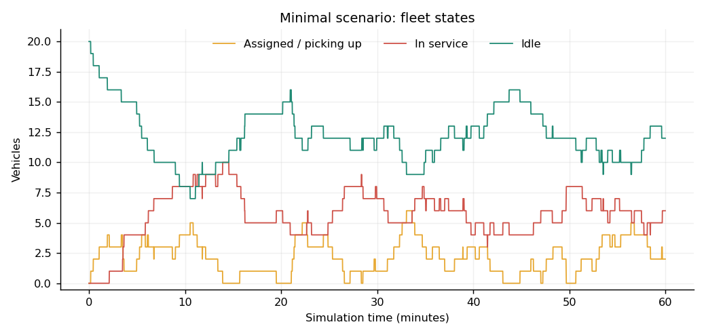

# DRT-ABM-simul

YuhuiZhai의 [Agent-Based-Simulation-for-Multi-Zone-Ride-pooling-Service](https://github.com/YuhuiZhai/Agent-Based-Simulation-for-Multi-Zone-Ride-pooling-Service)를 바탕으로 정리한 실행용 ride-pooling 시뮬레이터입니다. 원본 코드를 보존하고 최소 예제 실행, 입력 데이터 DB 구축, Excel·CSV·SQLite·그림·GIF 결과 생성을 추가했습니다.

## 먼저 결과 보기

이미 실행한 [최소 예제 결과](results/minimal/README.md)에서 그림과 수치를 확인할 수 있습니다.

- [Excel 결과 내려받기](https://github.com/jongho98/DRT-ABM-simul/raw/refs/heads/main/results/minimal/results.xlsx)
- [GIF 애니메이션](results/minimal/simulation.gif)
- [차량 상태 그래프](results/minimal/fleet_states.png)
- [승객 결과 그래프](results/minimal/passenger_outcomes.png)
- [결과 컬럼·단위·DB 조회 설명](docs/RESULTS_GUIDE.md)



## 설치 및 실행

Python 3.10 이상을 사용합니다. 저장소 루트에서 실행하십시오. 검증 환경의 정확한 버전은 `results/minimal/run_metadata.json`에 기록되어 있습니다.

```bash
git clone https://github.com/jongho98/DRT-ABM-simul.git
cd DRT-ABM-simul
python -m venv .venv
```

Windows PowerShell:

```powershell
.venv\Scripts\Activate.ps1
```

macOS / Linux:

```bash
source .venv/bin/activate
```

이후 공통 명령:

```bash
python -m pip install -r requirements.txt
python scripts/prepare_network.py
python run_simulation.py --config configs/minimal.json
python -m unittest discover -s tests -v
```

`prepare_network.py`는 원본 `.xls`를 CSV와 `data/processed/network.sqlite`로 정리합니다. 최소 Manhattan 예제는 합성 좌표 공간을 사용하므로 이 도로망 DB가 실행의 필수 입력은 아닙니다. 데이터베이스 서버 설치는 필요하지 않습니다.

`run_simulation.py`를 다시 실행하면 같은 출력 폴더의 결과를 갱신합니다. 다른 실험을 보존하려면 다음처럼 경로를 지정하십시오.

```bash
python run_simulation.py --config configs/minimal.json --output results/experiment_01
```

GIF 생성을 생략하려면 `--no-gif`를 추가합니다. 기본 Git 설정은 검증된 `results/minimal/`만 추적합니다. 추가 실험 결과를 올리려면 `.gitignore`에 해당 폴더를 추가로 허용하십시오.

## 최소 실행 설정

[configs/minimal.json](configs/minimal.json)을 수정합니다. 단위는 거리 mile, 속도 mile/hour, 입력 시간은 이름에 명시된 hour 또는 second입니다.

| 설정 | 기본값 | 의미 |
|---|---:|---|
| `city_type` | Manhattan | 연속 좌표의 직교 거리 공간 |
| `length_miles` | 3.6 | 정사각형 한 변 |
| `speed_mph` | 18 | 차량 속도 |
| `fleet_size` | 20 | 차량 대수 |
| `arrival_rate_per_hour` | 50 | 구역 전체 요청 발생률 |
| `duration_hours` | 1 | 시뮬레이션 시간 |
| `resolution_seconds` | 1 | 시간 스텝 |
| `policy` | sharing | simple / sharing / batch |
| `detour_distance_miles` | 1 | 합승 삽입 시 추가거리 상한. 비율이 아님 |
| `batch_interval_seconds` | 60 | batch 방식에서만 사용하는 배차 간격 |
| `pickup_radius_miles` | null | batch 픽업거리 제한. null은 제한 없음 |
| `local_reallocation` / `swap` | false | 지역 재배치 / 픽업 차량 교환 |
| `seeds` | 3 / 4 / 2 | 승객 OD / 차량 초기 위치 / 도착시각 난수 |
| `snapshot_seconds` | 60 | 궤적·GIF 기록 간격 |
| `animation_fps` | 10 | GIF 초당 프레임 수 |

동일 시드로 정책이나 차량 수를 바꾸면 같은 요청시각·OD를 사용합니다. Excel의 config 시트는 실행 설정의 기록이며, 셀을 바꾸어도 시뮬레이션이 재실행되지는 않습니다. 설정 JSON을 수정하고 Python을 다시 실행해야 합니다.

## 폴더와 DB 구조

| 경로 | 역할 |
|---|---|
| `src/drt_abm/` | 수정된 실행용 City·Passenger·Taxi·배차 코드 |
| `upstream/yuhuizhai/` | 원본 Python 코드와 README의 변경 없는 보관본 |
| `upstream/manifest.json` | 원본 커밋·파일 경로·Git blob 해시 |
| `configs/` | 실행 설정 |
| `data/raw/` | 원본 node.xls / link.xls |
| `data/processed/` | 정규화된 nodes.csv / links.csv / network.sqlite |
| `results/minimal/` | 실제 실행한 최소 예제의 모든 결과 |
| `scripts/prepare_network.py` | 도로망 정리·DB 생성 |
| `tests/` | 오류 회귀·수요 보존·합승 순서·재현성 검증 |
| `docs/` | 변경사항·결과 읽기·검증 기록 |

## 원본과 달라진 점 및 지원 범위

우회거리의 방향 오류, 빈 큐 처리, 기간 밖 요청 생성, batch의 요청 누락·중복 집계, 합승 추가 승객의 배차시각 누락 등을 고쳤습니다. 차량 위치와 수요의 난수를 분리하고 동률 차량 선택 순서를 고정했습니다. `local_reallocation=false`이면 유휴 차량은 현재 위치에서 대기합니다. [전체 변경사항](docs/CHANGES.md)을 확인하십시오.

지원하는 기본 실행 경로는 **단일 구역 Manhattan / Euclidean의 simple·sharing·batch**입니다. 합승은 한 번에 등록 승객 최대 2명, 서비스 중 차량 우선, 새 승객을 먼저 하차시키는 원본 정책을 유지합니다. 실제 도로망 차량 이동은 원본에서 미완성이므로 데이터 준비까지만 제공하고 실행 시 명시적으로 중단합니다. 다중 구역 초기화는 고쳤고 `gr=False` 핵심 검사를 통과했지만, PuLP 기반 구역 간 최적화·GUI·버스 예제는 기본 실행 경로와 검증 범위에서 제외합니다.

원본 고정 커밋: `f46db88dcabad541cb08d5fbb0ff95f027c8d2ad`. 출처와 보관 범위는 [UPSTREAM.md](UPSTREAM.md)에 기록했습니다.
