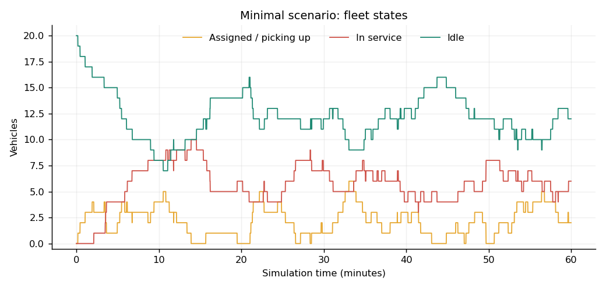
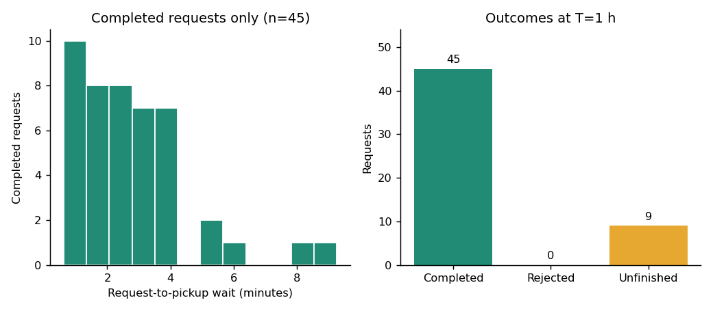
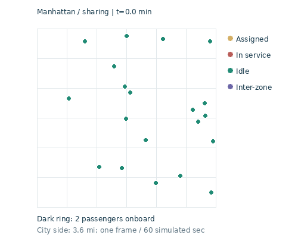

# 시뮬레이션 결과: minimal

설정: Manhattan, 차량 20대, 시간당 요청 50건, 1시간, 1초 스텝, 우회거리 상한 1 mile.

| 지표 | 결과 |
|---|---:|
| 생성 요청 | 54 |
| 배정 | 54 |
| 완료 | 45 |
| 거절 | 0 |
| 종료 시 미완료 | 9 |
| 서비스 중 차량에 추가 배정 | 5 |
| 실제 동승 경험 승객 | 9 |
| 완료 승객 평균 대기시간(분) | 2.770 |
| 완료 승객 평균 총 소요시간(분) | 9.826 |

## 파일 보기

- [results.xlsx](results.xlsx): 내려받아 Excel에서 summary → fleet_timeseries → passengers 순으로 확인합니다.
- [summary.json](summary.json): 수치 요약과 지표 정의.
- [passengers.csv](passengers.csv): 요청별 시각, OD, 최종 상태, 대기·차내·총시간. 빈 시각은 아직 이벤트가 발생하지 않았다는 뜻입니다.
- [requests.csv](requests.csv): 실제 생성된 입력 수요. 출발·도착 좌표 단위는 mile, 요청시각 단위는 hour입니다.
- [simulation.sqlite](simulation.sqlite): 같은 결과를 저장한 SQLite DB입니다.
- [run_metadata.json](run_metadata.json): 실행 버전과 원본·실행 코드 해시.

완료 승객 평균은 종료 시 미완료 요청을 제외합니다. T 이후 승객을 끝까지 운송하는 배출 구간은 없습니다. `assigned_to_busy_vehicle`와 실제 동승 경험은 다른 지표입니다. 이 예제는 합성 Manhattan 공간이며 data/raw의 실제 도로망을 사용하지 않습니다.

재실행: 저장소 루트에서 `python run_simulation.py --config configs/minimal.json`.
상세 컬럼 해설과 DB 조회: [결과 가이드](../../docs/RESULTS_GUIDE.md).
